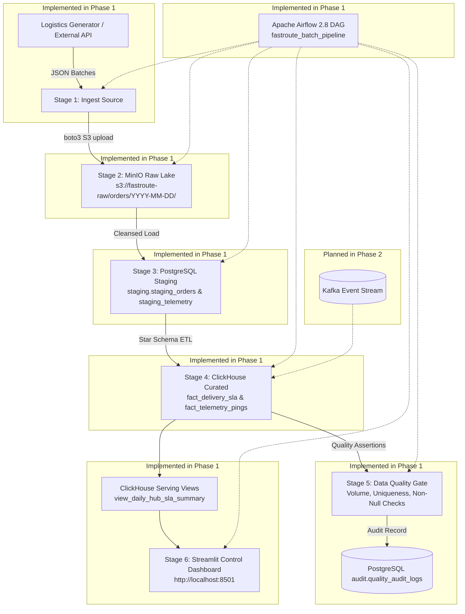

# FastRoute Logistics — End-to-End Data Platform Project Plan

## 1. Problem Statement
**Industry**: Logistics & Express Package Delivery.  
**Business Question**: How can FastRoute Logistics optimize route SLA compliance, pinpoint dispatch bottlenecks across regional fulfillment hubs, and proactively flag anomalous/corrupted IoT telemetry data?  
**Target Consumers**: Logistics Operations Managers, Regional Hub Dispatchers, Data Analysts, and Fleet Operations Directors.  
**Decision Supported**: Operational resource reallocation, courier route reassignment, real-time SLA breach alerting, and vendor telemetry hardware maintenance.

---

## 2. Component-Role Mapping

| Pipeline Component | Assigned Technology | Specific Role in Platform | Phase 1 Status |
| :--- | :--- | :--- | :--- |
| **Data Source & Generator** | Python `LogisticsDataGenerator` | Synthetic package orders & GPS telemetry generator with controlled corruptions | **Implemented** |
| **Raw Storage Landing Lake** | MinIO S3 Object Lake | Immutable S3 raw landing storage partitioned by `logical_date` | **Implemented** |
| **Operational Staging DB** | PostgreSQL 16 | Relational staging layer with delete-then-insert idempotency & audit logging | **Implemented** |
| **Analytical OLAP Warehouse** | ClickHouse 24.3 | Columnar analytical warehouse materializing star schema (`fact_delivery_sla`, `fact_telemetry_pings`) | **Implemented** |
| **Data Quality Gate** | Python `DataQualityValidator` + SQL | Automated assertions (row count >= 1000, not-null, uniqueness) failing bad runs | **Implemented** |
| **Serving & Consumption** | ClickHouse Views & Streamlit UI | Queryable analytical views (`view_daily_hub_sla_summary`) & interactive dashboard | **Implemented** |
| **Orchestrator** | Apache Airflow 2.8 | Orchestrates 6 discrete pipeline tasks with parameterization, retries, and failure gates | **Implemented** |
| **Continuous Streaming Broker** | Apache Kafka | Real-time continuous courier GPS event stream | *Planned for Phase 2* |

---

## 3. Target Architecture Diagram



---

## 4. Tech Stack Table

| Component | Selected Technology | Reason for Selection | Alternative Rejected & Reason |
| :--- | :--- | :--- | :--- |
| **Orchestrator** | Apache Airflow 2.8 | Standard industry tool, rich Python DAG API, robust retry logic & monitoring | Prefect (Less ubiquitous in traditional enterprise data engineering pipelines) |
| **Object Lake** | MinIO | Standard S3-compatible API, lightweight Docker deployment, persistent storage | Local Filesystem (Lacks S3 protocol realism and bucket policy features) |
| **Staging DB** | PostgreSQL 16 | ACID compliance, strong JSONB support, ideal staging & metadata store | MySQL (Inferior JSON features and window function performance) |
| **OLAP Engine** | ClickHouse 24.3 | Blazing fast columnar aggregation over millions of telemetry rows, vector processing | Snowflake (Costly cloud dependency not suitable for offline local reproducibility) |
| **Interactive UI** | Streamlit | Rapid interactive Python UI framework, native DB connectivity, immediate user feedback | Grafana (Lacks custom interactive controls for pipeline execution and tests) |
| **Data Quality** | Custom SQL + Python Validator | Lightweight, fast validation, zero complex dependency overhead, fails run on error | Great Expectations (Heavy configuration overhead for phase 1) |

---

## 5. Data Model

```
RAW LAYER (MinIO):
s3://fastroute-raw/orders/{YYYY-MM-DD}/orders_{YYYY-MM-DD}.json
s3://fastroute-raw/telemetry/{YYYY-MM-DD}/telemetry_{YYYY-MM-DD}.json
       │
       ▼
STAGING LAYER (PostgreSQL 16):
├── staging.staging_orders (order_id PK, tracking_number, customer_id, origin_hub, dest_hub, weight, promised_hours, status, batch_date)
├── staging.staging_telemetry (ping_id PK, courier_id, latitude, longitude, speed_kmh, battery_pct, recorded_at, batch_date)
├── staging.couriers (courier_id PK, full_name, vehicle_type, home_hub, active_status)
├── staging.hubs (hub_id PK, hub_name, city, latitude, longitude)
└── audit.quality_audit_logs (audit_id PK, batch_id, logical_date, dataset_name, total, passed, failed, failure_reasons)
       │
       ▼
CURATED / SERVING LAYER (ClickHouse 24 Star Schema):
├── dim_couriers (ReplacingMergeTree: courier_id, full_name, vehicle_type, home_hub, active_status)
├── dim_hubs (ReplacingMergeTree: hub_id, hub_name, city, latitude, longitude)
├── fact_delivery_sla (ReplacingMergeTree: order_id, tracking_number, customer_id, origin_hub, dest_hub, promised_hours, actual_hours, is_sla_breached, created_date)
├── fact_telemetry_pings (ReplacingMergeTree: ping_id, courier_id, latitude, longitude, speed_kmh, battery_pct, ping_date, recorded_at)
├── view_daily_hub_sla_summary (Serving View: daily routes, total orders, breached orders, compliance %, avg delivery hours)
└── view_courier_sla_leaderboard (Serving View: daily courier stats, total pings, avg speed, battery)
```

---

## 6. Pipeline Design & Idempotency Strategy

- **Orchestration Approach**: Apache Airflow DAG (`fastroute_batch_pipeline`) scheduled `@daily` with 6 explicit single-responsibility tasks.
- **Task Dependencies**:
  ```
  1_ingest_source >> 2_raw_storage_landing >> 3_load_staging >> 4_transform_curated >> 5_run_quality_checks >> 6_publish_serving
  ```
- **Logical Date Parameterization**:
  The pipeline accepts `logical_date` (format: `YYYY-MM-DD`). Every hop filters, partitions, and loads data scoped to that date.
- **Idempotency Guarantee**:
  - *Raw*: Overwrites partition `s3://fastroute-raw/orders/{logical_date}/orders_{logical_date}.json`.
  - *Staging*: `DELETE FROM staging.staging_orders WHERE batch_date = %s` before insertion.
  - *Curated*: `ALTER TABLE fact_delivery_sla DELETE WHERE created_date = toDate('%s')` and `ReplacingMergeTree` deduplication.
  - *Re-running twice*: Generates identical row counts without duplication.
  - *Different dates*: Produces data for both dates without collision.
- **Deliberate Failure Switch**:
  Configurable via `FAIL_INGESTION=true` environment variable or DAG configuration `{"fail_ingestion": true}`. Ingestion raises `RuntimeError`, stopping downstream tasks.

---

## 7. Data Quality Plan

### Automated Checks Run in Stage 5:
1. **Row Count Threshold**: `fact_delivery_sla` count for `logical_date` must be >= 1,000 rows. (Fails run if violated).
2. **Not-Null Primary Key**: `countIf(order_id IS NULL) == 0`. (Fails run if violated).
3. **Primary Key Uniqueness**: `count() == uniqExact(order_id)`. (Fails run if violated).
4. **GPS Coordinate Range**: Lat in `[-90, 90]`, Lon in `[-180, 180]`, non-zero. (Fails run if violated).
5. **Positive Duration**: `actual_hours > 0`.

---

## 8. Changelog

### Phase 1 Changelog (2026-10-13)
- **Implemented 6-stage linear batch DAG**: Decomposed previous grouped tasks into 6 explicit single-responsibility stages.
- **Added Date Parameterization**: Every stage is now strictly parameterized by `logical_date` (e.g. `2026-10-13`).
- **Implemented Delete-then-Insert Idempotency**: Staging and ClickHouse tables now guarantee zero duplicate rows on re-runs.
- **Increased Volume**: Ingestion generated count scaled to 1,200 orders and 2,500 telemetry records (exceeding non-trivial requirement of >= 1,000).
- **Added Deliberate Failure Switch**: Configured `FAIL_INGESTION` switch with downstream task halting.
- **Added Automated Smoke Test**: Created `tests/smoke/test_smoke_pipeline.py` with one-command execution (`make smoke`).
- **Added Serving Views**: Deployed `view_daily_hub_sla_summary` and `view_courier_sla_leaderboard`.
- **Created ADR 001**: Documented architectural decisions in `docs/decisions/001-phase-1-batch-walking-skeleton.md`.
