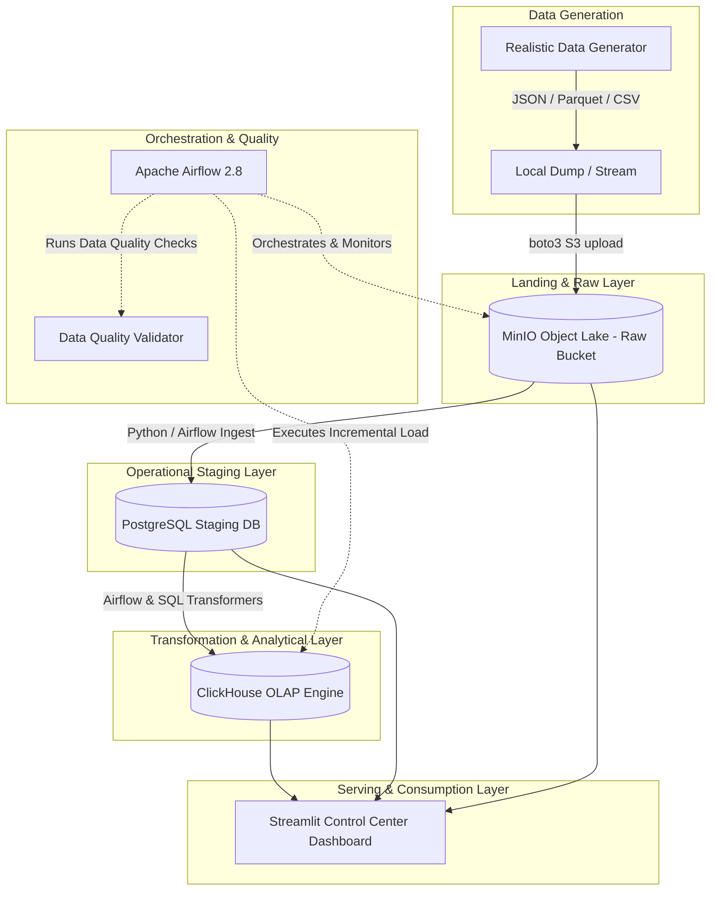

# FastRoute Logistics — End-to-End Data Platform Project Plan

## 1. Problem Statement
**Industry**: Logistics & Express Package Delivery.  
**Business Question**: How can FastRoute Logistics optimize route SLA compliance, pinpoint dispatch bottlenecks across regional fulfillment hubs, and proactively flag anomalous/corrupted IoT telemetry data?  
**Target Consumers**: Logistics Operations Managers, Regional Hub Dispatchers, Data Analysts, and Field Operations Directors.  
**Decision Supported**: Operational resource reallocation, courier route reassignment, real-time SLA breach alerting, and vendor telemetry hardware maintenance.

---

## 2. Data Sources
The platform ingests multi-format synthetic operational data generated by a realistic, parameter-controlled telemetry generator:

| Dataset | Format | Volume Estimate (Daily) | Frequency | Key Quality Issues / Schema Drift Injected |
| :--- | :--- | :--- | :--- | :--- |
| **Package Orders** | JSON | ~50,000 records | Real-time batch / Hourly | Missing customer IDs, duplicate order IDs, null delivery windows |
| **Driver Telemetry Pings** | Parquet / JSON | ~1,000,000 pings | 10-second intervals | Out-of-bounds GPS lat/lon (0,0 or off-grid), timestamp jitter, schema drift |
| **Hub Scanning Events** | CSV | ~200,000 events | Event-driven (batch 15m) | Inconsistent status enums, duplicate scan events |
| **SLA & Courier Master** | PostgreSQL table | ~5,000 couriers | Daily sync | Slow-changing attributes (courier vehicle type, shift zone) |

---

## 3. Target Architecture



### Component Walkthrough
1. **Data Generator**: Produces synthetic logistics events with controlled dirty records, missing fields, schema drift, and GPS noise.
2. **MinIO Object Lake**: S3-compatible raw storage landing zone storing immutable JSON/Parquet raw files under partition paths `s3://fastroute-raw/YYYY/MM/DD/`.
3. **PostgreSQL 16 Staging**: Operates as relational operational metadata store and staging buffer for cleansed transactional data and quality audit logs.
4. **ClickHouse 24.3 OLAP Engine**: High-performance column-oriented analytical engine serving aggregated SLA performance metrics, courier leaderboard, and delay root-cause tables.
5. **Apache Airflow 2.8**: Orchestrates ingestion schedules, dependency DAGs, validation gates, and incremental ClickHouse materialization.
6. **Streamlit Control Dashboard**: Interactive UI providing container health status, live data generation trigger, dataset exploration (MinIO/PostgreSQL/ClickHouse), and visual SLA analytics.

---

## 4. Tech Stack Table

| Component | Selected Technology | Reason for Selection | Alternative Rejected & Reason |
| :--- | :--- | :--- | :--- |
| **Orchestrator** | Apache Airflow 2.8 | Standard industry tool, rich Python DAG API, robust retry logic & monitoring | Prefect (Less ubiquitous in traditional enterprise data engineering pipelines) |
| **Object Lake** | MinIO | Standard S3-compatible API, lightweight Docker deployment, persistent storage | Local Filesystem (Lacks S3 protocol realism and bucket policy features) |
| **Staging DB** | PostgreSQL 16 | ACID compliance, strong JSONB support, ideal staging & metadata store | MySQL (Inferior JSON features and window function performance) |
| **OLAP Engine** | ClickHouse 24.3 | Blazing fast columnar aggregation over millions of telemetry rows, vector processing | Snowflake (Costly cloud dependency not suitable for offline local reproducibility) |
| **Interactive UI** | Streamlit | Rapid interactive Python UI framework, native DB connectivity, immediate user feedback | Grafana (Lacks custom interactive controls for data generation and DAG triggers) |
| **Data Quality** | Pydantic + Custom SQL | Lightweight, fast validation, zero complex dependency overhead | Great Expectations Heavy Suite (Complex configuration setup for early phase development) |

---

## 5. Data Model

```
RAW LAYER (MinIO): s3://fastroute-raw/orders/, s3://fastroute-raw/telemetry/
       │
       ▼
STAGING LAYER (PostgreSQL):
├── staging_orders (order_id, tracking_number, origin_hub, dest_hub, status, created_at)
├── staging_telemetry (ping_id, courier_id, lat, lon, speed_kmh, battery_pct, recorded_at)
└── staging_scans (scan_id, package_id, hub_id, scan_type, scanned_at)
       │
       ▼
CURATED / SERVING LAYER (ClickHouse Star Schema):
├── dim_couriers (courier_id, full_name, vehicle_type, vehicle_capacity, home_hub_id, active_status)
├── dim_hubs (hub_id, hub_name, city, latitude, longitude, processing_capacity)
├── fact_delivery_sla (order_id, courier_id, origin_hub_id, dest_hub_id, promised_hours, actual_hours, is_sla_breached, delivery_date)
└── fact_telemetry_pings (ping_id, courier_id, event_date, timestamp, lat, lon, speed, is_anomalous)
```

- **Grain**:
  - `fact_delivery_sla`: One row per completed package order.
  - `fact_telemetry_pings`: One row per GPS telemetry ping event.
- **Primary & Sorting Keys**:
  - ClickHouse `fact_delivery_sla`: `ORDER BY (delivery_date, origin_hub_id, order_id)`
  - ClickHouse `fact_telemetry_pings`: `ORDER BY (event_date, courier_id, timestamp)`
- **Incremental & SCD Strategy**:
  - `dim_couriers`: SCD Type 1 (overwrite with audit timestamp).
  - `fact_delivery_sla`: Incremental append based on batch `created_at` timestamp.

---

## 6. Pipeline Design

- **Orchestration Approach**: Apache Airflow DAG scheduled hourly (`0 * * * *`).
- **Batch vs. Streaming**: Micro-batch processing (15-minute ingestion micro-batches into MinIO, hourly transformation into ClickHouse).
- **Idempotency & Re-run Strategy**:
  - MinIO partition keys based on execution date `YYYY/MM/DD/HH`.
  - PostgreSQL staging uses `ON CONFLICT (order_id) DO UPDATE` or staging trunk-and-load per execution run.
  - ClickHouse uses `ReplacingMergeTree` engine or partitioned `INSERT` by execution date to guarantee duplicate-free idempotency.
- **Failure Handling**:
  - Airflow task retries (3 retries with exponential backoff).
  - Data quality gate failures trigger quarantine log in `quality_audit_logs` table without failing whole DAG unless critical threshold (>20% corruption) is breached.
- **Expected Runtime**: < 45 seconds per hourly batch execution on standard development hardware.

---

## 7. Data Quality Plan

### Automated Checks
1. **Null & Uniqueness Checks**: `order_id` and `ping_id` must not be null and must be unique per batch.
2. **Coordinate Range Verification**: GPS `lat` must be within `[-90, 90]` and `lon` within `[-180, 180]`. Non-zero coordinates enforced (flag `(0,0)` anomalies).
3. **Timestamp Jitter & Sequence Check**: Delivery scan timestamps cannot precede order creation timestamps.
4. **SLA Threshold Sanity Check**: `actual_hours` must be positive (> 0).

### Action on Failure
- Invalid rows are logged into `quality_audit_logs` table with rejection cause.
- If invalid records < 10% of batch: quarantine bad rows, process valid subset, send slack/log alert.
- If invalid records >= 10%: stop pipeline execution, mark task as failed, require manual dispatcher review.

---

## 8. Phase Roadmap

### Phase 0 — Infrastructure & Project Skeleton (Current)
- **Scope**: Repository layout, Docker Compose setup (PostgreSQL, MinIO, ClickHouse, Airflow, Streamlit), pinned configs, `.env.example`, runnable module placeholders, interactive UI.
- **Definition of Done**: All services start clean via `docker compose up`, UI accessible at `localhost:8501`, unit tests pass, documentation complete.

### Phase 1 — Ingestion & Raw Landing
- **Scope**: Synthetic data generator with dirty record injection, S3 client uploading JSON/Parquet files to MinIO raw buckets.
- **Definition of Done**: Automated generator script runs, landing files visible in MinIO bucket via UI and S3 API.

### Phase 2 — Staging & Data Quality Enforcement
- **Scope**: MinIO -> PostgreSQL staging loader, Pydantic validation layer, quality audit table logging.
- **Definition of Done**: Valid rows land in PostgreSQL staging, bad records quarantined, quality metrics displayed on Streamlit dashboard.

### Phase 3 — ClickHouse OLAP Transformation & Modeling
- **Scope**: Star schema creation in ClickHouse, SQL transformations, incremental materialization scripts.
- **Definition of Done**: Curated tables populated, query latency < 100ms for 10M aggregated telemetry rows.

### Phase 4 — Airflow DAG Orchestration
- **Scope**: End-to-end Airflow DAG combining ingestion, quality gates, staging, and ClickHouse loading with alert notifications.
- **Definition of Done**: DAG executes end-to-end on schedule, backfills pass successfully, Airflow UI displays clean DAG run history.

### Phase 5 — Serving Layer & Interactive Dashboard Polish
- **Scope**: Streamlit Control Dashboard enhancements: real-time map plotting courier GPS paths, SLA breach heatmaps, and system controls.
- **Definition of Done**: Non-technical stakeholder can generate data, trigger DAG, view live delivery map, and analyze SLA metrics.

---

## 9. Risks & Assumptions

| Risk | Impact | Likelihood | Mitigation |
| :--- | :--- | :--- | :--- |
| ClickHouse container memory limit on Docker Desktop | High | Medium | Limit batch insert memory in config; set Docker memory reservation to 4GB |
| Airflow scheduler startup delay or DB lock | Medium | Low | Use explicit dependency healthchecks (`depends_on: postgres: condition: service_healthy`) |
| Schema drift breaking ingestion parsing | High | Medium | Enforce defensive Pydantic models with `extra="allow"` or quarantine unparsed JSON payloads |

---

## 10. How to Run

### Prerequisites
- Docker & Docker Compose (v2.20+)
- Python 3.10+ (for local development/testing)

### Quick Start Commands
```bash
# 1. Clone repo & copy environment variables
git clone https://github.com/imranquliyev/1st_e2e_data_platform_project.git
cd 1st_e2e_data_platform_project
cp .env.example .env

# 2. Spin up local data platform infrastructure
docker compose up -d --build

# 3. Access Services
# Streamlit Control Center UI: http://localhost:8501
# Apache Airflow UI: http://localhost:8080 (User: airflow / Pass: airflow)
# MinIO S3 Console: http://localhost:9001 (User: minioadmin / Pass: minioadmin)
# ClickHouse HTTP API: http://localhost:8123

# 4. Run local tests
python3 -m pytest tests/
```
